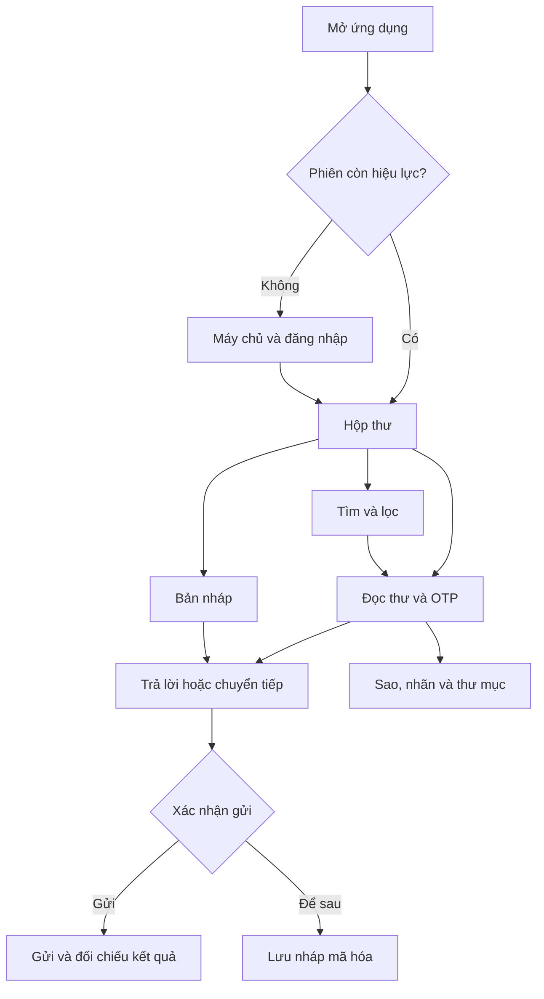

# User-flow sketch

## State sketches
- Inbox: toolbar → heading/unread count → search → folder filters → priority OTP → mail rows → floating compose → bottom navigation.
- Reader: back/actions → subject/labels → sender/time → optional generated summary → original native-rendered body → attachments → reply/forward.
- Compose: close/title/send → sender → To/CC/BCC → subject → body → attachments → formatting/insert bar → draft status.
- Login: brand/title → deployment URL → email/password → field errors → sign in → server capability/permission errors.

Wireframe mode in mockup.html removes color/elevation and exposes the same layout structure. Detailed secondary screens remain in task T002 and are not claimed as finished high-fidelity screens.
